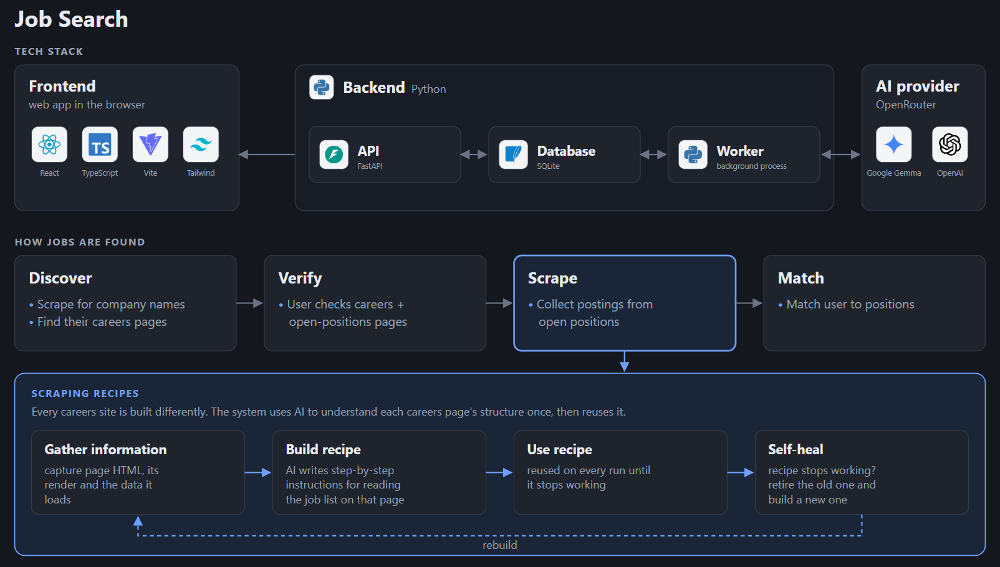

# Job Search

A local-first tool that finds technology employers, lets a human check their
careers pages, collects the open positions from the employers' own sites, and
ranks those positions against your CV.

It is also an experiment in **self-healing scrapers**. Every careers site is
built differently. Instead of hand-written code per site, an LLM studies a page
once and writes a *recipe*: a small, typed description of where the job list is
and how to page through it. Plain code then replays that recipe on every run,
with no LLM calls. When a recipe stops working, the system retires it and
builds a new one.

**Demo video:** <https://youtu.be/QslqJAJsUe8>



## How jobs are found

| Step | What happens |
|---|---|
| **Discover** | Search the web and pasted listing pages (rankings, articles, tables) for company names, then search for each company's careers page. |
| **Verify** | A human accepts or rejects each company and its careers page. Only accepted companies are scraped. |
| **Scrape** | Find the page that lists all open positions, then collect the postings. Uses a known job-board API, embedded JSON-LD, plain HTML, a headless browser, or an LLM-authored recipe. |
| **Match** | Extract a structured profile from each posting (role, skills, location, seniority) and score it against the evidence from your CV. |
| **Tailor** | Draft CV variants for one job, backed only by evidence you gave. Nothing is used without your approval. |

## Highlights

- **LLM-authored, code-replayed scraping recipes.** The model proposes, code
  verifies. A recipe is accepted only when its replay returns postings, and a
  separate model check asks one question before a recipe is trusted: is
  anything here a real job posting? See [docs/scraping-recipes.md](docs/scraping-recipes.md).
- **Employer pages over job boards.** A job board is used only when the
  employer's own careers page links to it. This rule is enforced in code and
  covered by tests.
- **Human in the loop.** No run accepts a company, a URL or application
  material on its own.
- **Measured, not guessed.** A benchmark suite with hand-labelled companies
  measures each stage: careers page → listing page → postings. The numbers,
  good and bad, are in [docs/status-and-limitations.md](docs/status-and-limitations.md).
- **Polite by design.** Per-host rate limits, bounded page counts, and one
  paid search request per company.
- **About 1,200 offline tests** (pytest and Vitest). Live LLM tests are opt-in.

## Tech stack

| Part | Technology |
|---|---|
| Web app | React, TypeScript, Vite, Tailwind, TanStack Query |
| API | Python, FastAPI (enqueues work and reads results; runs no pipeline code) |
| Worker | Python background process that executes queued runs |
| Core | `packages/core`: discovery, scraping, recipes, matching, CV parsing |
| Database | SQLite with Alembic migrations (applied automatically at startup) |
| Browser tier | Playwright, for JavaScript-only careers pages |
| LLM | Any model through OpenRouter |
| Search | Brave Search API (DuckDuckGo and self-hosted SearXNG also work) |

## Quick start

Tested on Linux (WSL). Requires Python 3.11+, [uv](https://docs.astral.sh/uv/)
and Node.js 20+.

```bash
# 1. Python environment (one shared venv for all packages)
uv sync --extra dev --all-packages
uv run playwright install chromium   # optional: browser tier

# 2. Keys and settings
cp .env.example .env                 # add OPENROUTER_API_KEY and BRAVE_SEARCH_KEY
mkdir -p data                        # database, cache and your CV live here

# 3. Web app dependencies
cd apps/web && npm ci --legacy-peer-deps && cd ../..
```

Run three processes from the repository root, each in its own terminal:

```bash
uv run uvicorn jobsearch_api.app:app --port 8000   # API
uv run python -m jobsearch_worker                  # worker: executes queued runs
cd apps/web && npm run dev                         # web app: open the URL Vite prints
```

Without the worker, runs stay `queued`. The worker reads `config/` relative to
the current directory, so start it from the repository root.

### Command line

The same pipeline is available without the web app:

```bash
uv run jobsearch discover        # find companies and careers pages
uv run jobsearch verify          # accept or reject them
uv run jobsearch scrape          # collect postings from accepted companies
uv run jobsearch match           # score postings against your profile
uv run jobsearch tailor <job_id> # draft a CV variant for one job
```

`tailor` needs your own Typst CV templates in `data/cv_templates/`
(`backend.typst`, `data.typst`, `ai.typst`).

## Configuration

| File | Controls |
|---|---|
| `.env` | API keys, model names, database path, LLM rate limits |
| `config/defaults.yaml` | search backend, budgets, page caps, extraction limits |
| `config/scopes/tech.yaml` | discovery segments and query templates |
| `config/role_taxonomy.yaml` | role groups, roles and title keywords used in matching |
| `config/countries.yaml` | all ISO 3166-1 countries with aliases |
| `config/filters.yaml` | rules that flag postings (a flag lowers the rank; it does not hide the posting) |
| `config/entry_vocabulary.yaml` | multilingual link text that leads to "open positions" pages |

Your CV, profile and the database stay in `data/`, which git ignores.

## Tests

```bash
uv run --extra dev pytest tests/
uv run --extra dev ruff check packages/ tests/
cd apps/web && npm test
```

## Repository layout

```
apps/
  api/      FastAPI app
  cli/      `jobsearch` command
  web/      React app
  worker/   background run executor
packages/core/   shared logic (jobsearch_core) and Alembic migrations
config/          YAML configuration
benchmarks/      measurement harnesses
tests/           pytest suite and fixtures
docs/            architecture and design notes
```

## Documentation

- [Architecture](docs/architecture.md): components, data model, and the rules
  that are easy to break by accident
- [Design decisions](docs/design-decisions.md): why the system works the way it does
- [Scraping recipes](docs/scraping-recipes.md): the self-healing scraper experiment
- [Status and limitations](docs/status-and-limitations.md): what works, measured numbers, known gaps
- [Benchmarks](benchmarks/README.md)

## Status

A personal portfolio project. The full pipeline works end to end through the
web app, and development is paused. This repository is a cleaned snapshot of a
private working repository, so it has no development history. Code comments
sometimes refer to internal planning documents (`master_plan`, `plan-*.md`)
that are not part of this snapshot.

The tool is for personal, local use. Scraping rules and terms of service differ
by site: respect them, and keep the rate limits on.

## License

All rights reserved. The code is public for portfolio, demonstration and
evaluation purposes only; see [LICENSE](LICENSE).
